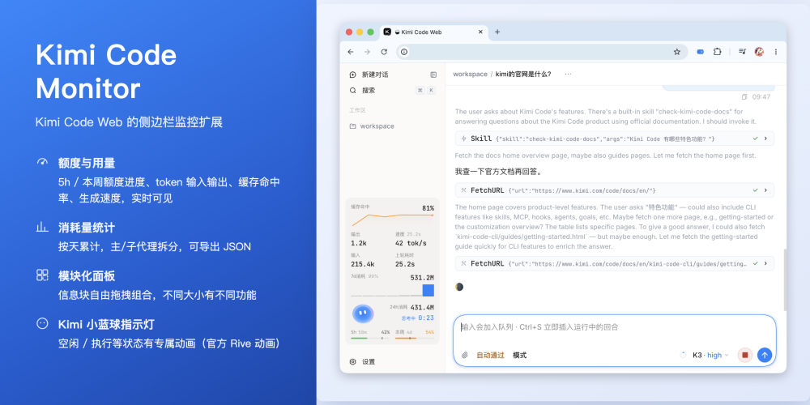
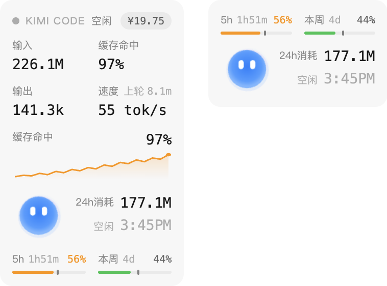
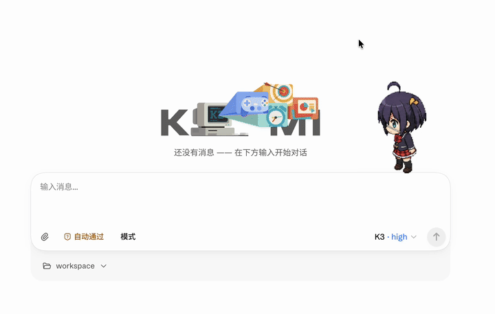
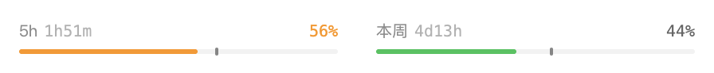
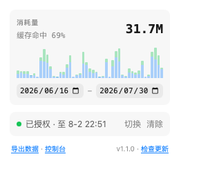
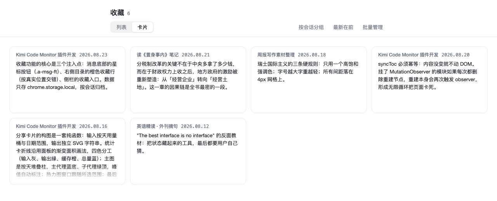
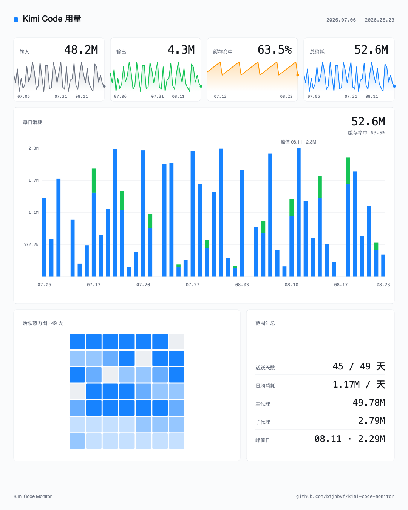
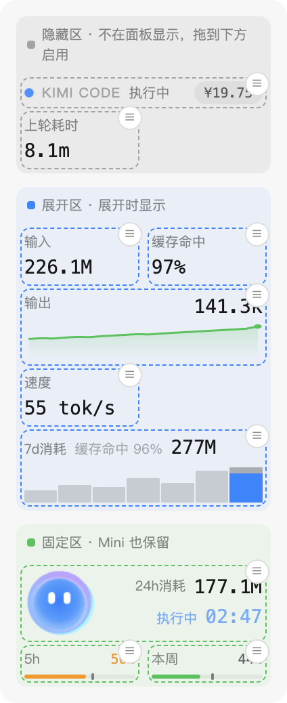

# Kimi Code Monitor

<p align="center"><strong>简体中文 | <a href="README.en.md">English</a></strong></p>

> [一、主要特性](#一主要特性)：[宠物](#通用-codex-桌面宠物) · [用量分析](#用量分析) · [AI 回复收藏](#ai-回复收藏) · [分享卡片](#用量分享卡片) · [吉祥物](#会反映状态的吉祥物) · [自定义面板](#模块化自定义面板) · [自动归档](#自动归档不活跃对话实验性) · [更多](#更多)
>
> [**二、安装与授权**](#二安装与授权)：[客户端](#二安装与授权) · [Chrome 插件](#二安装与授权) · [CLI HUD](#二安装与授权)
>
> [三、数据与隐私](#三数据与隐私)
>
> [四、技术实现](#四技术实现)


> **桌面客户端支持（macOS / Windows）**：同一套面板可以补丁形式装进 Kimi Code 桌面客户端的会话侧边栏——不改客户端程序逻辑，自动备份、可随时完整卸载。(web端宠物等功能在桌面端中暂不支持)
>
> 推荐经运维技能安装：把下面这段话发给桌面客户端里的 Kimi，它会先装好技能，再按技能指引完成面板安装：
>
> ```text
> 请根据 https://raw.githubusercontent.com/bfjnbvf/kimi-code-monitor/main/docs/SKILL-INSTALL.md ，安装 kimi-code-monitor 技能；装好启用后，按技能指示帮助我安装 Kimi Code 客户端面板。
> 
> ```



Kimi Code Web 的侧边栏监控扩展，同一套面板也支持 Kimi Code 桌面客户端（macOS / Windows，补丁形式安装）。一套完整的用量分析与分享 + 一只兼容 Codex 格式的桌面宠物 + 一个便于整理回看的 AI 回复收藏夹。

### 三个版本

同一套面板/思路拆成三个可独立安装的版本，Release 里分开发布：

| 版本 | 形态 | 安装 | Release 资产 |
|---|---|---|---|
| **Web 扩展** | Chrome / Edge 侧边栏面板 | 加载 zip 到 `chrome://extensions` | `kimi-code-monitor-v*.zip` |
| **桌面客户端** | Kimi Code 桌面端补丁（侧边栏面板 + 缓存提醒） | 解压运行 `install.sh` / `install.cmd` | `kcm-desktop-patch.zip` |
| **终端 CLI HUD**（实验） | 原生 `kimi` 的状态栏 | 解压后 `node scripts/install-cli-hud.mjs` | `kimi-code-monitor-cli-v*.zip` |
| 运维技能（可选） | 给 Kimi 的技能包 | 解压到 `~/.kimi-code/skills/` | `kimi-code-monitor-skill.zip` |

> CLI HUD 是独立实现，不改 Kimi 本体，也不依赖 Web/桌面代码；目前作者只在 Windows 的 Kimi 2.2/2.3 上验证过，macOS/Linux 与真实订阅额度尚未实测。



## 一、主要特性

### 通用 Codex 桌面宠物

在页面上养一只像素宠物。它会跟着你的工作节奏变换动作：你提问时它埋头干活，干完了示意你来看结果，出错或掉线时沮丧地低下头，平时安安静静待着。



- 完全兼容 Codex 官方宠物素材格式：打开弹窗，从宠物画廊（[codexpet.top](https://codexpet.top/zh)、[petdex.dev](https://petdex.dev)）复制一条安装命令、粘贴、点安装即可
- 可以同时收藏多只，一键切换；鼠标悬停打招呼、按住拖拽停放、靠近时转过脸看你（v2 素材）；大小 50%–150% 可调

### 用量分析

- **额度进度条**：5 小时与本周额度，附重置倒计时和一条匀速参照线——按时间均匀消耗此刻该到的位置，超过就是用得偏猛
- **消耗量**：连接本地 Kimi CLI 后按天统计本机 token 消耗（24h / 7 天 / 30 天），主/子代理堆叠展示
- **折线图**：统计模块拉成整宽后显示当前会话的逐轮变化曲线，悬停看每个点的数值
- **Popup 完整版**：按天消耗图表（自定义日期范围）、140 天活跃热力图、数据导出（不含对话内容）
- **额度预警**：5h / 本周额度超过 80% 和 95% 时桌面通知





### AI 回复收藏

看到值得留存的回答，点它底部操作行的星标即可收藏。

- 收藏的回复以**橙色目录行**进入右侧消息目录，点击即跳回原文
- 侧栏「收藏」入口打开整页收藏页：**列表 / 卡片双视图**、按会话分组与时间排序、批量管理（全选 / 删除所选）
- 点开任意一条弹出详情卡：上一轮用户提问 + Markdown 完整还原的回复全文 + 跳转原文按钮
- 支持跨会话跳转；收藏数据只存在本地
- 弹窗「扩展功能」卡片提供总开关（默认开），关闭后星标与收藏页一并隐藏，数据保留



### 用量分享卡片

popup 消耗量板块点「生成分享图」，按当前选择的日期范围生成一张 1080×1350 分享卡片：四张统计卡（输入 / 输出 / 缓存命中 / 总消耗，各带渐变折线与关键日期标签）、每日消耗堆叠柱图（纵轴参照线）、活跃热力图、范围汇总（活跃天数 / 日均 / 主子代理 / 峰值日）。

支持下载 2x 高清 PNG，或直接复制到剪贴板。



### 会反映状态的吉祥物

面板里住着 Kimi 官方蓝色小球（与 kimi.com 对话页同款动画）。空闲时呼吸并显示当前时间；开始工作后变成加载动画并给本轮回答计时（调用工具不打断）；回答结束撒花庆祝；限流、子代理工作、掉线重连各有专属动作。点一下它，会随机做个小动作。

它右侧的状态文字区分「思考中」（模型生成）和「执行中」（工具调用），颜色随状态变化；数据位可在六种口径间切换：24h 消耗 / 输入 / 输出 / 缓存命中 / 速度 / 余额。

桌面端多一个**缓存过期提醒**：最后一轮之后 27 分钟，宠物球会持续变红（复用限流的红色外观），四槽改成「对话缓存 / 即将过期 / 预估剩余 / 3:00 倒计时」，大字缓慢脉冲。30 分钟后停止脉冲、球变灰，改成「对话缓存 / 可能过期 / 已闲置 / 已闲置分钟数」，一直留到你再次输入。阈值按本机实测的约 30 分钟有效 TTL 估算，文案带「预估/可能」；宠物 ≡ 菜单里可以关闭。

### 模块化自定义面板

面板的每个信息块都是独立模块，可以自由组合。模块大小也可以自由调整——不同大小呈现不同内容：半宽只保留核心数字，拉成整宽则会展开折线图、消耗量柱图等更多细节。

- **长按**进入编辑模式，把模块拖到三个区域：隐藏 / 仅完整模式显示 / Mini 保留
- 同一区域内拖动排序，半宽整宽混排（像磁贴一样）
- 每个模块的 ≡ 菜单里有它的专属设置



### 自动归档不活跃对话（实验性）

按静默天数把不活跃的对话自动移入侧栏「已完成」，保持「进行中」列表干净。三档规则独立可调、可单独启停（规则行带悬浮解释与勾选框）：

- **单日对话**：创建后不到 2 天的短会话（当天一次性任务），默认静默 **3** 天归档
- **多日对话**：跨 2 天以上持续使用的会话（隔几天回来一次），默认静默 **14** 天归档
- **所有对话**：不论活跃跨度，静默 **30** 天一律归档（兜底）

首次开启会先列出符合条件的会话清单，确认后一键归档并解锁自动归档；此后每 24 小时后台执行一次，结果桌面通知。正在工作、等待交互、子会话、创建不满 24 小时与空会话绝不归档。归档完全可逆，Kimi Web 的「已归档会话」页可随时恢复。判定只用列表接口的创建/更新时间，纯本地计算，不读取对话内容。开启时自动打开 Kimi Web 实验性「多标签页侧栏」。

### 更多

- 加油包余额显示，点击直达充值页（可改为控制台）
- 侧栏美化（可开关）：隐藏侧栏顶部 logo，新建对话按钮上移，与伸缩按钮排成一行

## 二、安装与授权

<details>
<summary>客户端 Skill 版（macOS / Windows 桌面客户端，推荐）</summary>

唯一前提：装好了 Kimi Code 桌面客户端。安装器会借客户端自带的运行时，**不需要安装 Node，也不产生任何系统级文件**（所有写入都在客户端自己的资源目录里）。

**方式一（推荐）：让 Kimi 自己装**

把下面这段话发给桌面客户端里的 Kimi，它会先装好技能，再按技能指引完成面板安装：

```text
请根据 https://raw.githubusercontent.com/bfjnbvf/kimi-code-monitor/main/docs/SKILL-INSTALL.md ，安装 kimi-code-monitor 技能；装好启用后，按技能指示帮助我安装 Kimi Code 客户端面板。
```

**方式二：手动安装**

1. 从 [Releases](https://github.com/bfjnbvf/kimi-code-monitor/releases) 下载 `kcm-desktop-patch.zip` 并解压
2. macOS 在终端执行 `bash install.sh`；Windows 直接双击 `install.cmd`（或在 cmd 里运行）。客户端不在默认位置时追加 `--app "<客户端目录>"`
3. 重载客户端（macOS `Cmd+R`，Windows `Ctrl+R`），面板出现在会话侧栏底部

安装幂等，可反复执行；`--uninstall` 完整卸载（还原原始文件）。客户端大版本更新会清掉面板文件——重新执行一次安装即可，历史统计会重新扫描补齐，使用期间攒的数据存在客户端自己的存储里，不受影响。

卸载与日常运维见 [docs/DESKTOP-PATCH.md](docs/DESKTOP-PATCH.md)；自检与供应商余额排查由运维技能负责。

</details>

<details>
<summary>Pro 插件版（Chrome / Edge 浏览器扩展）</summary>

需要 Chrome 120 或更高版本。

**方式一（推荐）：下载构建好的 zip**

从 [Releases](https://github.com/bfjnbvf/kimi-code-monitor/releases) 下载最新的 `kimi-code-monitor-v*.zip`，解压后在 `chrome://extensions` 开启开发者模式，加载解压目录即可。

> 注意：GitHub 的「Code → Download ZIP」下载的是**源码包**（`kimi-code-monitor-main`），里面没有 `dist/` 产物，直接加载会报「无法为脚本加载 JavaScript dist/content.js」。不想自己构建的话请用 Releases 里的 zip。

**方式二：源码构建**

0. 首次使用先构建：`npm install && npm run build`（把 `src/` 打成 `dist/`；之后改了源码就再跑一次 `npm run build`）
1. 在 `chrome://extensions` 开启开发者模式，加载本目录（或解压 zip 后加载）
2. 打开 `kimi web` 启动的本地页面
3. 默认端口（58627）直接可用；若用 `kimi web --port` 换了端口，点扩展图标 →「在此站点启用」，页面会自动刷新一次
4. 首次加载会显示新手引导；面板提示授权时点击完成一次设备授权
5. 如需24h、7天、30天长期统计，在消耗量模块或右上角 popup 点击“连接本地 CLI”，选择 sessions 目录：macOS / Linux 默认为 `~/.kimi-code/sessions`，Windows 默认为 `%USERPROFILE%\.kimi-code\sessions`

> `.kimi-code` 是隐藏目录。macOS 的目录选择器按 `⌘⇧.` 显示隐藏目录；Linux 通常按 `Ctrl+H`；Windows 可按 `Ctrl+L` 后粘贴上述路径。若配置过 `KIMI_CODE_HOME`，请选择其中的 `sessions` 目录。

> 在 `chrome://extensions` 重新加载扩展后，需要手动刷新一次 Kimi Code Web 页面，面板才会恢复。

扩展使用自己的 OAuth token，不读写 Kimi Code CLI 的凭据。CLI 目录授权仅用于可选的长期用量统计。

</details>

<details>
<summary>终端 CLI HUD（实验）</summary>

Kimi Code CLI 2.2.0+ 的原生状态栏 HUD，独立于 Web / 桌面，不修改 Kimi 本体。

**安装**：从 Releases 下载 `kimi-code-monitor-cli-v*.zip`，解压后：

```bash
node scripts/install-cli-hud.mjs --width 120
kimi
```

需要 Node.js 20+、Python 3.10+。已有 Kimi 窗口需退出后重开；安装器备份 `~/.kimi-code/tui.toml`，只改 `[status_line].command`。

**卸载**：

```bash
node scripts/install-cli-hud.mjs --uninstall
```

详见 [docs/CLI-HUD.md](docs/CLI-HUD.md)。当前为实验版：作者只在 Windows 的 Kimi 2.2/2.3 上验证过，macOS/Linux 与真实订阅额度尚未实测。

</details>

## 三、数据与隐私

- **数据默认只进内存**：输入/输出/缓存/速度与折线图只维护当前页面，不上传；未连接本地 CLI 时，长期统计保持锁定
- **连接后也只读用量**：仅提取 `wire.jsonl` 里的 `usage.record` 用量记录与模型名（自动整理同样只读会话列表的元数据）——不保存、不上传对话原文、工具参数与回答内容
- **收藏只存本地**：每条收藏保存 turnId、会话/提问摘录与一段渲染后的回复 HTML（单条上限约 150KB），删除收藏或卸载扩展即清除；收藏页在独立的扩展标签页打开，正文不进入宿主页面 DOM
- **凭据加密落盘**：OAuth token 与外部 API key 经本机加密库（AES-GCM）存储；扩展不读写 Kimi Code CLI 的凭据
- **消息来源校验**：后台只放行扩展页面与「默认端口 / 已在弹窗授权的站点」的内容脚本。默认端口由静态规则覆盖，其他端口需在弹窗点「在此站点启用」——未启用的本机页面没有内容脚本，面板与收藏都不会挂载
- **官方 RC 站点静态授权**：`code-rc.kimi.com` 在安装时即获得站点权限并静态注入面板，以便 Chrome 站点菜单直接启用；为让 Rive WASM 编译，只对该站主文档移除 CSP 头。其他自建 `kimi web --host` 地址仍在弹窗里手动授权
- **一处已知可探测性**：Rive 动画资产对所有 http(s) 页面可见，网页可借此探测本机是否安装了本扩展；除此之外扩展不向任意网页暴露资源或接口

## 四、技术实现

面板本体是一个注入 kimi web 页面的内容脚本：从页面 WebSocket 事件流还原会话状态，DOM 挂在侧边栏内，数据只进内存、不上传；额度与授权走扩展后台的 OAuth 通道，长期用量统计来自显式授权后对本地 CLI 会话文件的增量读取。

桌面客户端（补丁形态）与扩展共用 `src/content/` 的同一套面板本体与渲染层，但数据链路完全不同——不经过扩展后台，全部直连客户端自己：`loader.js` 注入客户端页面（脚本标签带载荷内容哈希穿透缓存，原始 `index.html` 自动备份、卸载逐字节还原）；面板的 `direct.js` 直连同机 kap-server——WebSocket 事件流还原会话状态、REST 轮询额度与加油包余额；外部账户读取客户端自己的供应商配置（key 只在内存里用一次，不落盘），直连各厂商的余额端点，每 60 秒刷新、失败时沿用上次成功的数值并标注数据时间；长期统计由安装器全量扫描 `~/.kimi-code/sessions` 预填（按天 / 按小时 / 按会话的代理 × 模型汇总），之后在页面内继续实时积累。安装零前提的实现：两个「点火壳」（`install.sh` / `install.cmd`）优先借客户端内置的 Node 运行时（Electron 的 `ELECTRON_RUN_AS_NODE`），系统 Node 兜底；安装逻辑只有 `install.mjs` 一份，跨 macOS / Windows。

源码在 `src/`（ES modules），`npm run build` 用 esbuild 打出 `dist/`（content/background/popup/panel-app 四个 bundle）；`npm test` 先构建再跑全部测试（含发版守卫）。四个运行面的目录划分与各模块职责见 [docs/ARCHITECTURE.md](docs/ARCHITECTURE.md)。
